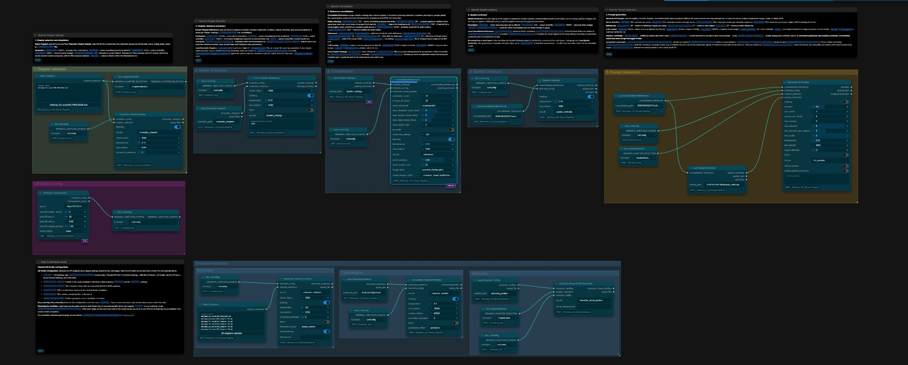

# MiniMax H3 Novel Pipeline

Turn novel chapters into organized character, location and object references, then prepare scene prompts for MiniMax H3. The plugin helps keep details consistent across chapters. It creates text and prompts; it does not generate images, audio or video.



## Install

1. Install [ComfyUI](https://github.com/comfyanonymous/ComfyUI) and [LM Studio](https://lmstudio.ai/).
2. Clone this repository into `ComfyUI/custom_nodes/`:

   ```sh
   git clone https://github.com/yuyuki/ComfyUI-Minimax_H3_Novel_Pipeline.git custom_nodes/minimax_h3_novel_pipeline
   ```

3. Install the plugin dependencies with the same Python environment used by ComfyUI:

   ```sh
   python -m pip install -r custom_nodes/minimax_h3_novel_pipeline/requirements.txt
   ```

4. Restart ComfyUI and refresh the browser.

## First run

1. In LM Studio, load a supported Qwen or Mistral model and start its local API server.
2. In **ComfyUI Settings → MiniMax H3 Novel → LM Studio**, set the API key. If authentication is off in LM Studio, use `lm-studio`.
3. Add **LM Studio Configuration** to your workflow. The default server address is `http://127.0.0.1:1234/v1`. For another address, set the same value as **Trusted API URL** in ComfyUI settings.
4. Connect **Select Chapters** → **Cinematic Chapter Adapter** → **Extract Chapter References** → **Consolidate References** → **Generate H3 Prompts**. Share the configuration with each processing node and connect the chapter selection to Generate as well.
5. Choose your chapter files, then queue the workflow. The plugin saves results under `ComfyUI/output/minimax_h3_novel/`.

The chapter picker supports TXT, Markdown and searchable PDF files. Review the adapter's chapter scenes before extraction, or reload edited scenes with **Load Cinematic Chapters**. See [examples](examples/README.md) for workflow details and saved-file loading.

## Nodes

| Node | What it does |
| --- | --- |
| **LM Studio Configuration** | Shares the model and connection settings used by the AI processing nodes. |
| **Select Chapters** | Picks chapter files or a folder to process. |
| **Cinematic Chapter Adapter** | Turns chapter text into ordered, reviewable scene outlines. |
| **Load Cinematic Chapters** | Loads saved scene outlines for another workflow run. |
| **Extract Chapter References** | Finds characters, places, objects and story details in chapters. |
| **Load Chapter Catalogs** | Loads saved chapter-by-chapter reference results. |
| **Consolidate References** | Combines chapter references into a shared registry and creates image/audio briefs. |
| **Load Consolidated References** | Loads a saved registry to continue without repeating consolidation. |
| **Generate H3 Prompts** | Builds scene prompts and reference instructions for MiniMax H3. |
| **Spatial Continuity** | Plans character, object, location and camera positions across scenes. |
| **Load Spatial Continuity** | Loads and checks an edited spatial-continuity plan. |
| **Character Evidence Extractor** | Collects quoted, chapter-linked evidence about character appearance. |
| **Load Character Evidence** | Loads saved or manually edited character evidence. |
| **Consolidate Character Profiles** | Groups evidence into source-linked character profiles. |
| **Load Character Profiles** | Loads and validates saved character profiles. |
| **Character Visual Profile Generator** | Extracts validated permanent physical traits for selected chapters without model calls. |
| **Load Character Visual Profiles** | Loads saved physical character profiles for Consolidate References. |


## Major changes by release

Highlights for repository releases; see the full [changelog](CHANGELOG.md) for details.

| Release | Highlights |
| --- | --- |
| **2.0.0** | Adds a source-linked character evidence and profile workflow, including visual profiles and loaders. |
| **1.10.x** | Improves scene pacing, reference selection, image prompt exports and publishing checks. |
| **1.9.0** | Adds Qwen/Mistral model selection, model profiles and stronger prompt validation. |
| **1.4.0** | Adds registry summaries and improved visual design handling. |
| **1.0.0** | Establishes the chapter selection and extract, consolidate, generate workflow. |

## More

- [Example workflow and wiring guide](examples/README.md)
- [Full changelog](CHANGELOG.md)
- [License](LICENSE)
