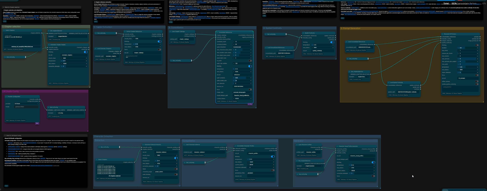

# MiniMax H3 Novel Pipeline

Turn novel chapters into organized character, location and object references, then prepare scene prompts for MiniMax H3. The plugin helps keep details consistent across chapters. It creates text and prompts; it does not generate images, audio or video.



## Install

1. Install [ComfyUI](https://github.com/comfyanonymous/ComfyUI). Install [LM Studio](https://lmstudio.ai/) if using a local model.
2. Clone this repository into `ComfyUI/custom_nodes/`:

   ```sh
   git clone https://github.com/yuyuki/ComfyUI-Minimax_H3_Novel_Pipeline.git custom_nodes/minimax_h3_novel_pipeline
   ```

3. Install the plugin dependencies with the same Python environment used by ComfyUI:

   ```sh
   python -m pip install -r custom_nodes/minimax_h3_novel_pipeline/requirements.txt
   ```

4. Restart ComfyUI and refresh the browser.

## First run

1. In **ComfyUI Settings → MiniMax H3 Novel → Providers**, enable LM Studio and/or OpenAI. Each card has its own **Test** and **Save** buttons; disabled cards collapse to their title and toggle. For LM Studio, load a supported model, start its API server and enter its URL and API key (use `lm-studio` if authentication is off). For OpenAI, enter your API key and model; the URL is fixed to `https://api.openai.com/v1`. OpenAI processing incurs API charges. Keys are masked, stored in ComfyUI settings, and excluded from workflows and outputs.
2. Add **Provider Configuration** and choose **LM Studio** or **OpenAI**. Only enabled providers with a saved API key and model appear. The node displays the saved model automatically and reads its API URL from settings. Qwen controls appear only for Qwen models in LM Studio. **Test** checks connectivity and model availability without generating text or saving drafts; **Save** applies the card. Fetch models in the provider card, select one and click **Save** before using the node. Restart ComfyUI and refresh the browser after updating this plugin.
3. Connect **Select Chapters** → **Cinematic Chapter Adapter** → **Extract Chapter References** → **Consolidate References** → **Generate H3 Prompts**. Share the configuration with each processing node and connect the adapter's cinematic_chapters output to Generate's cinematic_chapter input as well. Set the scene duration in Adapter; Generate reads it from each cinematic chapter.
4. Choose your chapter files, then queue the workflow. The plugin saves results under `ComfyUI/output/minimax_h3_novel/`.

The chapter picker supports TXT, Markdown and searchable PDF files. Review the adapter's chapter scenes before extraction, or reload edited scenes with **Load Cinematic Chapters**. See [examples](examples/README.md) for workflow details and saved-file loading.

The adapter estimates action and dialogue time before review and can split a sentence into several scenes to fit the configured maximum. Timing remains an estimate; incomplete checks or persistent overruns are recorded for review. Start a fresh adaptation when upgrading older resume checkpoints; completed cinematic chapters remain loadable.

If timing planning fails, independent narrative checks still run. Partial findings remain visible and are never treated as approval; validation failures include safe reason codes and field paths in the saved diagnostics.

Each processing node's `thinking` checkbox controls reasoning requests for Qwen, Gemma and Mistral in LM Studio. Saved configurations and stream logs reflect that setting. The loaded model and its chat template must support switching reasoning off; Gemma/Mistral requests fail if reasoning is returned while disabled. `reasoning_chars` reports the actual returned reasoning. GPT-OSS always reasons and reports `thinking=true`; its effort is set in LM Studio. Hosted OpenAI requests have no thinking control in this plugin. Character evidence auditing uses its separate `audit_thinking` checkbox.

Version 2.6.0 uses one H3 scene per cinematic sequence and validates continuity citations against the supplied evidence. Recreate Adapter and Generate nodes after updating; saved chapters must include the adaptation duration.

## Nodes

| Node | What it does |
| --- | --- |
| **Provider Configuration** | Shares the model and connection settings used by the AI processing nodes. |
| **Select Chapters** | Picks chapter files or a folder to process. |
| **Cinematic Chapter Adapter** | Turns chapter text into ordered, reviewable scene outlines. |
| **Load Cinematic Chapters** | Loads saved scene outlines for another workflow run. |
| **Extract Chapter References** | Finds characters, places, objects and story details in chapters. |
| **Load Chapter Catalogs** | Loads saved chapter-by-chapter reference results. |
| **Consolidate References** | Combines chapter references into a shared registry and creates image/audio briefs. |
| **Load Consolidated References** | Loads a saved registry to continue without repeating consolidation. |
| **Generate H3 Prompts** | Builds scene prompts and reference instructions for MiniMax H3. |
| **Spatial Continuity** | Plans character, object, location and camera positions across scenes. |
| **Load Spatial Continuity** | Loads and checks an edited spatial-continuity plan. |
| **Character Evidence Extractor** | Collects quoted, chapter-linked evidence about character appearance. |
| **Load Character Evidence** | Loads saved or manually edited character evidence. |
| **Consolidate Character Profiles** | Groups evidence into source-linked character profiles. |
| **Load Character Profiles** | Loads and validates saved character profiles. |
| **Character Visual Profile Generator** | Creates permanent physical designs, then uses LM Studio to review possible duplicate identities and update the same files. |
| **Load Character Visual Profiles** | Loads saved physical character profiles for Consolidate References. |

The visual generator first writes `visual_designs.json`, then checks possible duplicate identities against source evidence. Confirmed links update that file, `character_visual_profiles.json`, and the node output together. The upstream character profiles remain unchanged. Uncertain cases and conflicting edited defaults are listed in `character_visual_identity_review.json`; existing manual identity links are preserved. Review requests use the generator's `.cache/` folder and its optional token, context and retry controls.


## Major changes by release

Highlights for repository releases; see the full [changelog](CHANGELOG.md) for details.

| Release | Highlights |
| --- | --- |
| **2.0.0** | Adds a source-linked character evidence and profile workflow, including visual profiles and loaders. |
| **1.10.x** | Improves scene pacing, reference selection, image prompt exports and publishing checks. |
| **1.9.0** | Adds Qwen/Mistral model selection, model profiles and stronger prompt validation. |
| **1.4.0** | Adds registry summaries and improved visual design handling. |
| **1.0.0** | Establishes the chapter selection and extract, consolidate, generate workflow. |

## More

- [Example workflow and wiring guide](examples/README.md)
- [Full changelog](CHANGELOG.md)
- [License](LICENSE)
