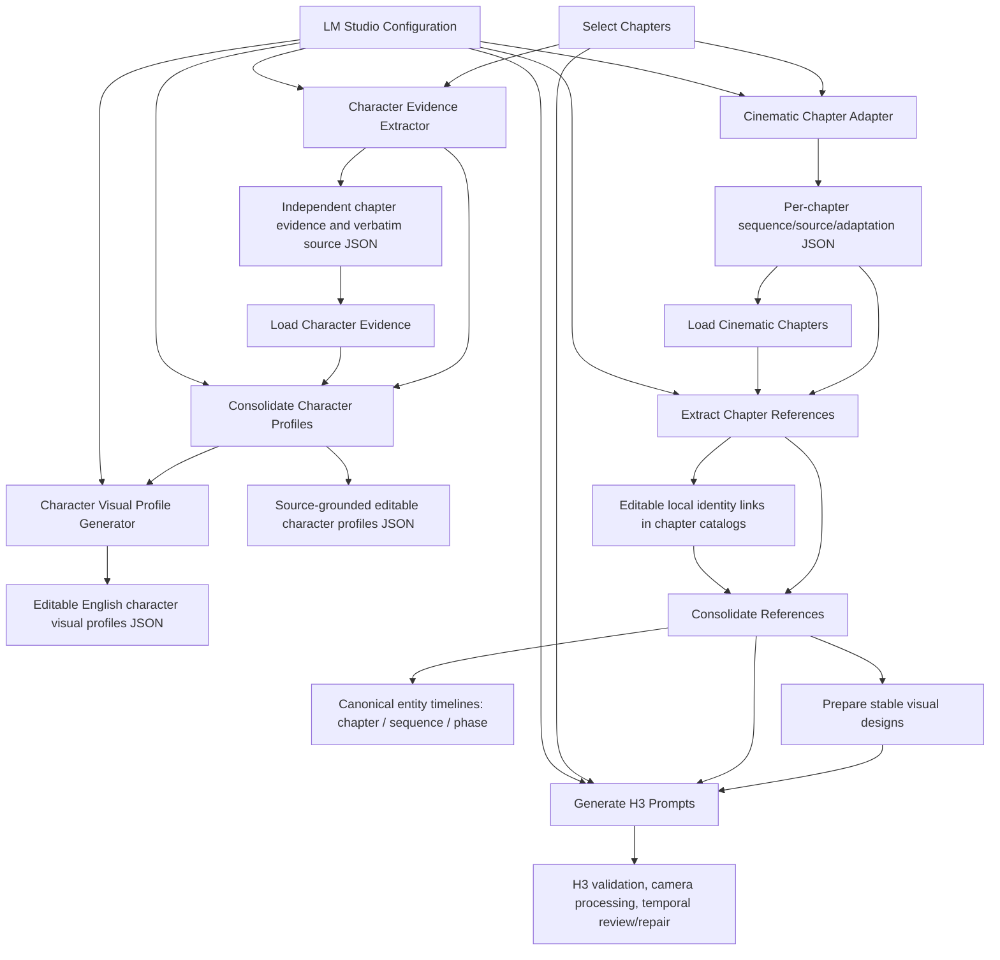

# Architecture map

> Generated by `python tools/generate_architecture.py`. Do not edit this file manually.

This map covers the active Python package in `src/`.
`src/nodes/` contains the ComfyUI nodes and their exports; `src/core/` contains shared logic and bundled JSON schemas. `src/__init__.py` registers the plugin and local HTTP routes.

## Pipeline flow

The node wrappers coordinate filesystem access, configuration snapshots and run outputs. The three `pipeline_step*` modules contain the LLM-facing stage implementations.
The standalone cinematic adapter uses `cinematic_adaptation` and the shared LM Studio JSON transport. Its ordered phases feed extraction; catalogs and registries retain temporal observations.
`narrative_validation` reviews adaptation source fidelity and transitions before targeted sequence repairs, and reviews extracted phases using only earlier identity context. Rejected phase results are not cached; persistent semantic defects stop the stage.
Adaptation repairs use the full passage source and neighboring sequences as context. When enabled targeted corrections are exhausted, one final source-bound reconstruction of the passage is reviewed before acceptance.

`reference_timeline` validates cinematic catalogs, merges observations without rewriting them, computes first occurrences and provides exact-address state lookup. Identity reconciliation and duplicate audits exclude temporal state; base image briefs use stable identity only.
Local `link_to_local_id` decisions are validated before model work and grouped before reconciliation. Every source ID maps to the unified entity, retaining all phase observations and unchanged chapter sequences. Image briefs cover all consolidated entities. `editable_schemas` validates and exports the visual design schema; extraction exports the chapter catalog schema.

## Internal module dependencies

Only modules with incoming or outgoing internal dependency edges are shown. Labels include registered ComfyUI node names.

```mermaid
flowchart TD
    m_package_init["package_init"]
    m_core_character_evidence["core.character_evidence"]
    m_core_character_profiles["core.character_profiles"]
    m_core_character_visual_profiles["core.character_visual_profiles"]
    m_core_cinematic_adaptation["core.cinematic_adaptation"]
    m_core_cinematic_references["core.cinematic_references"]
    m_core_configuration_snapshot["core.configuration_snapshot"]
    m_core_editable_schemas["core.editable_schemas"]
    m_core_image_prompt_export["core.image_prompt_export"]
    m_core_lmstudio_json["core.lmstudio_json"]
    m_core_lmstudio_model_mistral["core.lmstudio_model_mistral"]
    m_core_lmstudio_model_qwen["core.lmstudio_model_qwen"]
    m_core_lmstudio_models["core.lmstudio_models"]
    m_core_lmstudio_pipeline["core.lmstudio_pipeline"]
    m_core_lmstudio_settings["core.lmstudio_settings"]
    m_core_narrative_choices["core.narrative_choices"]
    m_core_narrative_validation["core.narrative_validation"]
    m_core_path_access["core.path_access"]
    m_core_pipeline_step1_extract["core.pipeline_step1_extract"]
    m_core_pipeline_step2_consolidate["core.pipeline_step2_consolidate"]
    m_core_pipeline_step3_generate["core.pipeline_step3_generate"]
    m_core_progress["core.progress"]
    m_core_prompt_cache["core.prompt_cache"]
    m_core_reference_requests["core.reference_requests"]
    m_core_reference_timeline["core.reference_timeline"]
    m_core_route_access["core.route_access"]
    m_core_run_output["core.run_output"]
    m_core_temporal_context["core.temporal_context"]
    m_core_util["core.util"]
    m_core_visual_designs["core.visual_designs"]
    m_nodes["nodes"]
    m_nodes_chapter_selection["nodes.chapter_selection<br/>Select Chapters"]
    m_nodes_character_evidence_extractor["nodes.character_evidence_extractor<br/>Character Evidence Extractor"]
    m_nodes_character_visual_profile_generator["nodes.character_visual_profile_generator<br/>Character Visual Profile Generator"]
    m_nodes_cinematic_chapter_adapter["nodes.cinematic_chapter_adapter<br/>Cinematic Chapter Adapter"]
    m_nodes_consolidate_character_profiles["nodes.consolidate_character_profiles<br/>Consolidate Character Profiles"]
    m_nodes_consolidate_references["nodes.consolidate_references<br/>Consolidate References"]
    m_nodes_extract_chapter_references["nodes.extract_chapter_references<br/>Extract Chapter References"]
    m_nodes_generate_h3_prompts["nodes.generate_h3_prompts<br/>Generate H3 Prompts"]
    m_nodes_lmstudio_config["nodes.lmstudio_config<br/>LM Studio Configuration"]
    m_nodes_load_chapter_catalogs["nodes.load_chapter_catalogs<br/>Load Chapter Catalogs"]
    m_nodes_load_character_evidence["nodes.load_character_evidence<br/>Load Character Evidence"]
    m_nodes_load_cinematic_chapters["nodes.load_cinematic_chapters<br/>Load Cinematic Chapters"]
    m_nodes_load_consolidated_references["nodes.load_consolidated_references<br/>Load Consolidated References"]
    m_nodes_load_spatial_continuity["nodes.load_spatial_continuity<br/>Load Spatial Continuity"]
    m_nodes_spatial_continuity["nodes.spatial_continuity<br/>Spatial Continuity"]
    m_package_init --> m_core_lmstudio_settings
    m_package_init --> m_core_path_access
    m_package_init --> m_core_route_access
    m_package_init --> m_nodes
    m_core_character_evidence --> m_core_lmstudio_json
    m_core_character_evidence --> m_core_lmstudio_pipeline
    m_core_character_evidence --> m_core_path_access
    m_core_character_evidence --> m_core_progress
    m_core_character_evidence --> m_core_prompt_cache
    m_core_character_evidence --> m_core_util
    m_core_character_profiles --> m_core_character_evidence
    m_core_character_profiles --> m_core_lmstudio_json
    m_core_character_profiles --> m_core_lmstudio_pipeline
    m_core_character_profiles --> m_core_prompt_cache
    m_core_character_profiles --> m_core_util
    m_core_character_visual_profiles --> m_core_character_profiles
    m_core_character_visual_profiles --> m_core_lmstudio_json
    m_core_character_visual_profiles --> m_core_lmstudio_pipeline
    m_core_character_visual_profiles --> m_core_prompt_cache
    m_core_character_visual_profiles --> m_core_util
    m_core_cinematic_adaptation --> m_core_lmstudio_json
    m_core_cinematic_adaptation --> m_core_lmstudio_pipeline
    m_core_cinematic_adaptation --> m_core_narrative_choices
    m_core_cinematic_adaptation --> m_core_narrative_validation
    m_core_cinematic_adaptation --> m_core_progress
    m_core_cinematic_references --> m_core_editable_schemas
    m_core_cinematic_references --> m_core_lmstudio_pipeline
    m_core_cinematic_references --> m_core_narrative_choices
    m_core_cinematic_references --> m_core_narrative_validation
    m_core_cinematic_references --> m_core_path_access
    m_core_cinematic_references --> m_core_progress
    m_core_cinematic_references --> m_core_prompt_cache
    m_core_cinematic_references --> m_core_temporal_context
    m_core_cinematic_references --> m_core_util
    m_core_configuration_snapshot --> m_core_lmstudio_json
    m_core_configuration_snapshot --> m_core_lmstudio_models
    m_core_configuration_snapshot --> m_core_util
    m_core_configuration_snapshot --> m_nodes_lmstudio_config
    m_core_editable_schemas --> m_core_path_access
    m_core_image_prompt_export --> m_core_path_access
    m_core_image_prompt_export --> m_core_util
    m_core_lmstudio_json --> m_core_lmstudio_model_qwen
    m_core_lmstudio_json --> m_core_lmstudio_models
    m_core_lmstudio_json --> m_core_lmstudio_pipeline
    m_core_lmstudio_models --> m_core_lmstudio_model_mistral
    m_core_lmstudio_models --> m_core_lmstudio_model_qwen
    m_core_lmstudio_pipeline --> m_core_lmstudio_json
    m_core_lmstudio_pipeline --> m_core_lmstudio_models
    m_core_lmstudio_pipeline --> m_core_lmstudio_settings
    m_core_narrative_validation --> m_core_lmstudio_pipeline
    m_core_pipeline_step1_extract --> m_core_lmstudio_json
    m_core_pipeline_step1_extract --> m_core_lmstudio_pipeline
    m_core_pipeline_step1_extract --> m_core_path_access
    m_core_pipeline_step1_extract --> m_core_progress
    m_core_pipeline_step1_extract --> m_core_prompt_cache
    m_core_pipeline_step1_extract --> m_core_util
    m_core_pipeline_step2_consolidate --> m_core_lmstudio_json
    m_core_pipeline_step2_consolidate --> m_core_lmstudio_pipeline
    m_core_pipeline_step2_consolidate --> m_core_progress
    m_core_pipeline_step2_consolidate --> m_core_reference_requests
    m_core_pipeline_step2_consolidate --> m_core_reference_timeline
    m_core_pipeline_step2_consolidate --> m_core_temporal_context
    m_core_pipeline_step3_generate --> m_core_cinematic_references
    m_core_pipeline_step3_generate --> m_core_lmstudio_json
    m_core_pipeline_step3_generate --> m_core_path_access
    m_core_pipeline_step3_generate --> m_core_progress
    m_core_pipeline_step3_generate --> m_core_prompt_cache
    m_core_pipeline_step3_generate --> m_core_reference_timeline
    m_core_pipeline_step3_generate --> m_core_temporal_context
    m_core_pipeline_step3_generate --> m_core_util
    m_core_prompt_cache --> m_core_lmstudio_json
    m_core_reference_requests --> m_core_lmstudio_json
    m_core_reference_requests --> m_core_lmstudio_pipeline
    m_core_reference_timeline --> m_core_cinematic_references
    m_core_reference_timeline --> m_core_util
    m_core_run_output --> m_core_path_access
    m_core_util --> m_core_path_access
    m_core_visual_designs --> m_core_editable_schemas
    m_core_visual_designs --> m_core_lmstudio_pipeline
    m_core_visual_designs --> m_core_progress
    m_core_visual_designs --> m_core_reference_requests
    m_core_visual_designs --> m_core_temporal_context
    m_core_visual_designs --> m_core_util
    m_nodes --> m_nodes_chapter_selection
    m_nodes --> m_nodes_character_evidence_extractor
    m_nodes --> m_nodes_character_visual_profile_generator
    m_nodes --> m_nodes_cinematic_chapter_adapter
    m_nodes --> m_nodes_consolidate_character_profiles
    m_nodes --> m_nodes_consolidate_references
    m_nodes --> m_nodes_extract_chapter_references
    m_nodes --> m_nodes_generate_h3_prompts
    m_nodes --> m_nodes_lmstudio_config
    m_nodes --> m_nodes_load_chapter_catalogs
    m_nodes --> m_nodes_load_character_evidence
    m_nodes --> m_nodes_load_cinematic_chapters
    m_nodes --> m_nodes_load_consolidated_references
    m_nodes --> m_nodes_load_spatial_continuity
    m_nodes --> m_nodes_spatial_continuity
    m_nodes_chapter_selection --> m_core_progress
    m_nodes_chapter_selection --> m_core_util
    m_nodes_character_evidence_extractor --> m_core_character_evidence
    m_nodes_character_evidence_extractor --> m_core_lmstudio_pipeline
    m_nodes_character_evidence_extractor --> m_core_progress
    m_nodes_character_evidence_extractor --> m_core_run_output
    m_nodes_character_evidence_extractor --> m_core_util
    m_nodes_character_evidence_extractor --> m_nodes_chapter_selection
    m_nodes_character_visual_profile_generator --> m_core_character_visual_profiles
    m_nodes_character_visual_profile_generator --> m_core_lmstudio_pipeline
    m_nodes_character_visual_profile_generator --> m_core_progress
    m_nodes_character_visual_profile_generator --> m_core_run_output
    m_nodes_cinematic_chapter_adapter --> m_core_cinematic_adaptation
    m_nodes_cinematic_chapter_adapter --> m_core_configuration_snapshot
    m_nodes_cinematic_chapter_adapter --> m_core_lmstudio_pipeline
    m_nodes_cinematic_chapter_adapter --> m_core_progress
    m_nodes_cinematic_chapter_adapter --> m_core_run_output
    m_nodes_cinematic_chapter_adapter --> m_core_util
    m_nodes_cinematic_chapter_adapter --> m_nodes_chapter_selection
    m_nodes_consolidate_character_profiles --> m_core_character_profiles
    m_nodes_consolidate_character_profiles --> m_core_lmstudio_pipeline
    m_nodes_consolidate_character_profiles --> m_core_progress
    m_nodes_consolidate_character_profiles --> m_core_run_output
    m_nodes_consolidate_references --> m_core_cinematic_references
    m_nodes_consolidate_references --> m_core_configuration_snapshot
    m_nodes_consolidate_references --> m_core_editable_schemas
    m_nodes_consolidate_references --> m_core_image_prompt_export
    m_nodes_consolidate_references --> m_core_lmstudio_pipeline
    m_nodes_consolidate_references --> m_core_progress
    m_nodes_consolidate_references --> m_core_reference_timeline
    m_nodes_consolidate_references --> m_core_run_output
    m_nodes_consolidate_references --> m_core_util
    m_nodes_consolidate_references --> m_core_visual_designs
    m_nodes_extract_chapter_references --> m_core_cinematic_references
    m_nodes_extract_chapter_references --> m_core_configuration_snapshot
    m_nodes_extract_chapter_references --> m_core_lmstudio_pipeline
    m_nodes_extract_chapter_references --> m_core_progress
    m_nodes_extract_chapter_references --> m_core_run_output
    m_nodes_extract_chapter_references --> m_core_temporal_context
    m_nodes_extract_chapter_references --> m_core_util
    m_nodes_generate_h3_prompts --> m_core_configuration_snapshot
    m_nodes_generate_h3_prompts --> m_core_image_prompt_export
    m_nodes_generate_h3_prompts --> m_core_lmstudio_pipeline
    m_nodes_generate_h3_prompts --> m_core_path_access
    m_nodes_generate_h3_prompts --> m_core_progress
    m_nodes_generate_h3_prompts --> m_core_run_output
    m_nodes_generate_h3_prompts --> m_core_util
    m_nodes_generate_h3_prompts --> m_nodes_chapter_selection
    m_nodes_generate_h3_prompts --> m_nodes_spatial_continuity
    m_nodes_lmstudio_config --> m_core_lmstudio_models
    m_nodes_lmstudio_config --> m_core_lmstudio_settings
    m_nodes_lmstudio_config --> m_core_progress
    m_nodes_lmstudio_config --> m_core_run_output
    m_nodes_load_chapter_catalogs --> m_core_cinematic_references
    m_nodes_load_chapter_catalogs --> m_core_configuration_snapshot
    m_nodes_load_chapter_catalogs --> m_core_progress
    m_nodes_load_chapter_catalogs --> m_core_util
    m_nodes_load_character_evidence --> m_core_character_evidence
    m_nodes_load_character_evidence --> m_core_progress
    m_nodes_load_character_evidence --> m_core_util
    m_nodes_load_cinematic_chapters --> m_core_cinematic_references
    m_nodes_load_cinematic_chapters --> m_core_configuration_snapshot
    m_nodes_load_cinematic_chapters --> m_core_progress
    m_nodes_load_cinematic_chapters --> m_core_util
    m_nodes_load_consolidated_references --> m_core_cinematic_references
    m_nodes_load_consolidated_references --> m_core_configuration_snapshot
    m_nodes_load_consolidated_references --> m_core_progress
    m_nodes_load_consolidated_references --> m_core_util
    m_nodes_load_spatial_continuity --> m_core_progress
    m_nodes_load_spatial_continuity --> m_core_util
    m_nodes_load_spatial_continuity --> m_nodes_spatial_continuity
    m_nodes_spatial_continuity --> m_core_editable_schemas
    m_nodes_spatial_continuity --> m_core_lmstudio_json
    m_nodes_spatial_continuity --> m_core_lmstudio_pipeline
    m_nodes_spatial_continuity --> m_core_narrative_choices
    m_nodes_spatial_continuity --> m_core_progress
    m_nodes_spatial_continuity --> m_core_run_output
    m_nodes_spatial_continuity --> m_core_util
```

## Module inventory

| Module | Internal dependencies | Public classes/functions |
|---|---|---|
| `src/__init__.py` | `core.lmstudio_settings`, `core.path_access`, `core.route_access`, `nodes` | — |
| `src/core/__init__.py` | — | — |
| `src/core/character_evidence.py` | `core.lmstudio_json`, `core.lmstudio_pipeline`, `core.path_access`, `core.progress`, `core.prompt_cache`, `core.util` | `extract_chapter`, `passages`, `read_source`, `validate_document`, `validate_result` |
| `src/core/character_profiles.py` | `core.character_evidence`, `core.lmstudio_json`, `core.lmstudio_pipeline`, `core.prompt_cache`, `core.util` | `build_profiles`, `consolidate`, `prepare_evidence` |
| `src/core/character_visual_profiles.py` | `core.character_profiles`, `core.lmstudio_json`, `core.lmstudio_pipeline`, `core.prompt_cache`, `core.util` | `affected_fields`, `blocked_fields`, `generate`, `prepare_profiles`, `validate_design` |
| `src/core/cinematic_adaptation.py` | `core.lmstudio_json`, `core.lmstudio_pipeline`, `core.narrative_choices`, `core.narrative_validation`, `core.progress` | `adapt_chapter`, `source_chunks` |
| `src/core/cinematic_references.py` | `core.editable_schemas`, `core.lmstudio_pipeline`, `core.narrative_choices`, `core.narrative_validation`, `core.path_access`, `core.progress`, `core.prompt_cache`, `core.temporal_context`, `core.util` | `assign_local_links`, `chapter_digest`, `copy_catalog_schema`, `parse_chapters`, `process_chapter` |
| `src/core/configuration_snapshot.py` | `core.lmstudio_json`, `core.lmstudio_models`, `core.util`, `nodes.lmstudio_config` | `complete`, `content_digest`, `file_digest`, `start` |
| `src/core/editable_schemas.py` | `core.path_access` | `export_schema`, `export_schemas`, `obj`, `validate_document` |
| `src/core/image_prompt_export.py` | `core.path_access`, `core.util` | `export_image_prompts` |
| `src/core/lmstudio_json.py` | `core.lmstudio_model_qwen`, `core.lmstudio_models`, `core.lmstudio_pipeline` | `chat_json`, `model_settings`, `parse_json`, `select_model` |
| `src/core/lmstudio_model_mistral.py` | — | `allows_chatml`, `matches`, `request_settings`, `retries`, `settings_from_config` |
| `src/core/lmstudio_model_qwen.py` | — | `allows_chatml`, `completion_options`, `is_qwen35`, `is_thinking_grammar_error`, `matches`, `request_settings`, `retries`, `settings_from_config`, `supports_thinking_prefill` |
| `src/core/lmstudio_models.py` | `core.lmstudio_model_mistral`, `core.lmstudio_model_qwen` | `get_profile`, `profile_for_model`, `select_family_model` |
| `src/core/lmstudio_pipeline.py` | `core.lmstudio_json`, `core.lmstudio_models`, `core.lmstudio_settings` | `comfy_interrupt_check`, `configure_qwen`, `load`, `make_client_and_model` |
| `src/core/lmstudio_settings.py` | — | `get_api_key`, `set_api_key`, `set_connection_settings`, `validate_api_url` |
| `src/core/narrative_choices.py` | — | `propose`, `resolve_chapter` |
| `src/core/narrative_validation.py` | `core.lmstudio_pipeline` | `review` |
| `src/core/path_access.py` | — | `confined_path`, `input_path`, `output_path`, `storage_root` |
| `src/core/pipeline_step1_extract.py` | `core.lmstudio_json`, `core.lmstudio_pipeline`, `core.path_access`, `core.progress`, `core.prompt_cache`, `core.util` | `assign_local_ids`, `clean_entity`, `combine_candidates`, `compact_strings`, `entity_schema`, `extract_chunk`, `hierarchical_merge_candidates`, `make_client`, `merge_candidates`, `merge_entity_schema`, `natural_key`, `process_chapter`, `sha256_file`, `slug` |
| `src/core/pipeline_step2_consolidate.py` | `core.lmstudio_json`, `core.lmstudio_pipeline`, `core.progress`, `core.reference_requests`, `core.reference_timeline`, `core.temporal_context` | `audit_registry`, `batched`, `build_audio_specs`, `build_chapter_map`, `build_entity_asset_index`, `build_picture_specs`, `candidate_catalog`, `compact_global`, `complete_image_prompt`, `dedupe`, `desired_base_views`, `generate_audio_assets`, `generate_picture_assets`, `incoming_entities`, `make_client`, `natural_key`, `next_global_id`, `norm_name`, `ordered_valid_views`, `picture_view_appearances`, `prepare_picture_appearances`, `reconcile_chapter`, `reconciliation_item_schema`, `similarity`, `stronger`, `threshold`, `write_asset_prompts` |
| `src/core/pipeline_step3_generate.py` | `core.cinematic_references`, `core.lmstudio_json`, `core.path_access`, `core.progress`, `core.prompt_cache`, `core.reference_timeline`, `core.temporal_context`, `core.util` | `Scene`, `Validation`, `ViewRequest`, `allowed_shots`, `audio_asset_for`, `available_assets_for_entity`, `best_asset_for_view`, `build_bindings`, `chapter_catalog`, `check_prompt_continuity`, `dedupe_scenes`, `default_view_order`, `entity_index`, `fingerprint`, `generate_prompt`, `jaccard`, `make_client`, `natural_key`, `normalize_prompt`, `pacing_instruction`, `picture_assets_by_entity`, `plan_scenes`, `process_chapter`, `prominence_score`, `refine_camera_prompt`, `repair_prompt`, `request_map`, `resolve_continuity`, `review_and_repair_continuity`, `save_scene`, `scene_asset_sheet`, `scene_from_dict`, `scene_to_dict`, `section_body`, `selected_timeline`, `sequence_catalog`, `slug`, `timestamp_seconds`, `validate_prompt` |
| `src/core/progress.py` | — | `node_progress`, `report`, `scope`, `steps` |
| `src/core/prompt_cache.py` | `core.lmstudio_json` | `fingerprint` |
| `src/core/reference_requests.py` | `core.lmstudio_json`, `core.lmstudio_pipeline` | `InvalidResponse`, `validate_assets`, `validated_request` |
| `src/core/reference_timeline.py` | `core.cinematic_references`, `core.util` | `merge_timeline`, `refresh_first_occurrence`, `state_at`, `validate_catalogs` |
| `src/core/route_access.py` | — | `require_local_request` |
| `src/core/run_output.py` | `core.path_access` | `execution_id`, `reserve_run`, `stage_output` |
| `src/core/temporal_context.py` | — | `normalize`, `prompt` |
| `src/core/util.py` | `core.path_access` | `catalog_summary`, `discover_inputs`, `load_json`, `natural_key`, `read_chapter`, `registry_summary`, `require_schema`, `save_json`, `split_chunks` |
| `src/core/visual_designs.py` | `core.editable_schemas`, `core.lmstudio_pipeline`, `core.progress`, `core.reference_requests`, `core.temporal_context`, `core.util` | `load_designs`, `object_schema`, `prepare_designs`, `resolve_designs_path`, `source_facts` |
| `src/nodes/__init__.py` | `nodes.chapter_selection`, `nodes.character_evidence_extractor`, `nodes.character_visual_profile_generator`, `nodes.cinematic_chapter_adapter`, `nodes.consolidate_character_profiles`, `nodes.consolidate_references`, `nodes.extract_chapter_references`, `nodes.generate_h3_prompts`, `nodes.lmstudio_config`, `nodes.load_chapter_catalogs`, `nodes.load_character_evidence`, `nodes.load_cinematic_chapters`, `nodes.load_consolidated_references`, `nodes.load_spatial_continuity`, `nodes.spatial_continuity` | — |
| `src/nodes/chapter_selection.py` | `core.progress`, `core.util` | `SelectChaptersNode`, `chapter_path_list`, `saved_chapter_choices` |
| `src/nodes/character_evidence_extractor.py` | `core.character_evidence`, `core.lmstudio_pipeline`, `core.progress`, `core.run_output`, `core.util`, `nodes.chapter_selection` | `CharacterEvidenceExtractorNode` |
| `src/nodes/character_visual_profile_generator.py` | `core.character_visual_profiles`, `core.lmstudio_pipeline`, `core.progress`, `core.run_output` | `CharacterVisualProfileGeneratorNode` |
| `src/nodes/cinematic_chapter_adapter.py` | `core.cinematic_adaptation`, `core.configuration_snapshot`, `core.lmstudio_pipeline`, `core.progress`, `core.run_output`, `core.util`, `nodes.chapter_selection` | `CinematicChapterAdapterNode` |
| `src/nodes/consolidate_character_profiles.py` | `core.character_profiles`, `core.lmstudio_pipeline`, `core.progress`, `core.run_output` | `ConsolidateCharacterProfilesNode` |
| `src/nodes/consolidate_references.py` | `core.cinematic_references`, `core.configuration_snapshot`, `core.editable_schemas`, `core.image_prompt_export`, `core.lmstudio_pipeline`, `core.progress`, `core.reference_timeline`, `core.run_output`, `core.util`, `core.visual_designs` | `ConsolidateReferencesNode` |
| `src/nodes/extract_chapter_references.py` | `core.cinematic_references`, `core.configuration_snapshot`, `core.lmstudio_pipeline`, `core.progress`, `core.run_output`, `core.temporal_context`, `core.util` | `ExtractChapterReferencesNode` |
| `src/nodes/generate_h3_prompts.py` | `core.configuration_snapshot`, `core.image_prompt_export`, `core.lmstudio_pipeline`, `core.path_access`, `core.progress`, `core.run_output`, `core.util`, `nodes.chapter_selection`, `nodes.spatial_continuity` | `GenerateH3PromptsNode` |
| `src/nodes/lmstudio_config.py` | `core.lmstudio_models`, `core.lmstudio_settings`, `core.progress`, `core.run_output` | `LMStudioConfigurationNode` |
| `src/nodes/load_chapter_catalogs.py` | `core.cinematic_references`, `core.configuration_snapshot`, `core.progress`, `core.util` | `LoadChapterCatalogsNode` |
| `src/nodes/load_character_evidence.py` | `core.character_evidence`, `core.progress`, `core.util` | `LoadCharacterEvidenceNode` |
| `src/nodes/load_cinematic_chapters.py` | `core.cinematic_references`, `core.configuration_snapshot`, `core.progress`, `core.util` | `LoadCinematicChaptersNode` |
| `src/nodes/load_consolidated_references.py` | `core.cinematic_references`, `core.configuration_snapshot`, `core.progress`, `core.util` | `LoadConsolidatedReferencesNode` |
| `src/nodes/load_spatial_continuity.py` | `core.progress`, `core.util`, `nodes.spatial_continuity` | `LoadSpatialContinuityNode` |
| `src/nodes/spatial_continuity.py` | `core.editable_schemas`, `core.lmstudio_json`, `core.lmstudio_pipeline`, `core.narrative_choices`, `core.progress`, `core.run_output`, `core.util` | `SpatialContinuityNode`, `validate_plan` |

Modules: **47**. Internal dependency edges: **176**.
