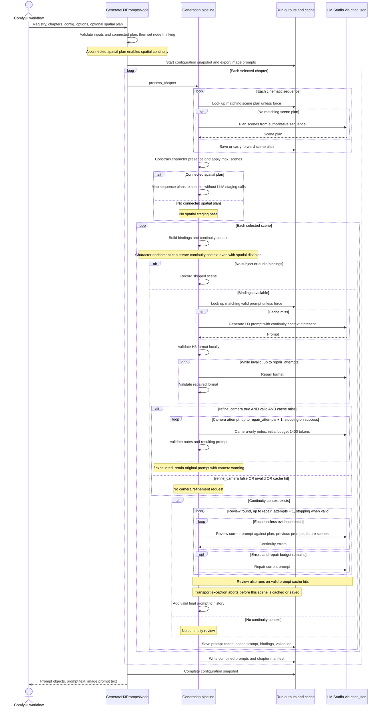

# Generate H3 Prompts: execution and failure analysis

This describes the implementation inspected on 2026-11-09. Related: [architecture map](../architecture.md), [node wrapper](../../src/nodes/generate_h3_prompts.py), [generation pipeline](../../src/core/pipeline_step3_generate.py), [JSON transport](../../src/core/lmstudio_json.py).

## Current sequence

Every LLM arrow below goes through the shared structured-JSON transport. One arrow can produce multiple HTTP requests through transport retries. All scenes are processed sequentially.

## Connection and camera control

| Connected spatial plan | Staging input | Final continuity review |
|---|---|---|
| Yes | Reuse connected sequence plan | Yes |
| No | No spatial staging | No, unless character enrichment creates continuity context |

`refine_camera` is independent of this table. It adds camera-only notes to a valid, newly generated prompt. Turning it off does not remove camera instructions already present in prompt generation, the spatial plan, or `camera_direction`. Its output is subsequently subject to continuity review.

Connect Spatial Continuity or Load Spatial Continuity to enable spatial planning context and final-prompt review. The redundant spatial checkbox and internal staging fallback have been removed. The connected plan defines intended staging; review checks actual generated wording. Camera refinement remains optional and independent.

The bundled example uses the current widget order. For other saved workflows containing the removed checkbox, recreate Generate H3 Prompts and reconnect its inputs before running, then restore the desired settings. This avoids positional widget values shifting into camera_direction or resume_run. No legacy widget format is supported.

## Diagnosis of the reported failure

The reported workflow connected Load Spatial Continuity (140) to Generate H3 Prompts (212). Node 212 had thinking on, max_tokens 8192, repair_attempts 2, refine_camera on, spatial continuity on, max_scenes 0 (all scenes), and no resume_run. The bundled example now omits the removed checkbox and retains that connection.

The failing call is the final-prompt continuity reviewer, not scene planning or camera refinement. The supplied trace records:

- HTTP 200: the server accepted and streamed the request.
- Attempt 2, max_tokens 16384, finish_reason length.
- 69,214 reasoning characters and zero answer-content characters.
- Parsing an empty answer raises JSONDecodeError, which the transport reports as StructuredOutputLengthError.

Reasoning and JSON share the completion budget. Gemma exhausted that budget before emitting JSON. The current Gemma profile allows one transport retry: an initial 8192-token request can retry at 16384 after reasoning truncation. It keeps thinking enabled. The configuration option qwen35_length_retries does not control Gemma. The node's repair_attempts controls semantic/format repair loops, not this transport retry count; a transport exception exits before a review result can be repaired.

LM Studio reports about 170.8 seconds for the last request. The 25,720-second ComfyUI profile is the cumulative node execution. These excerpts prove why the run stopped, but do not provide a per-stage breakdown of the preceding seven hours. They do not show a context-window overflow; increasing context size alone would not fix the output-budget failure. The attached text snapshot was empty.

## Performance and recovery findings

1. **Repeated chapter-wide review.** Each scene is reviewed against all previous valid final prompts and all remaining scenes. Context is packed without dropping evidence, with a 48,000 UTF-8-byte request budget; overflow creates additional review requests. Across N scenes this can approach quadratic evidence processing. Repairs repeat the batches.
2. **Nested retry costs.** With repair_attempts 2, a scene can have up to three camera attempts and three continuity review rounds, plus format and continuity repairs. Each LLM call can itself retry. Camera requests begin at only 1400 tokens while inheriting thinking; reasoning truncation can escalate their retry to 16384 tokens.
3. **Cached prompts still incur review.** A valid matching prompt skips generation and camera refinement, but not continuity review. A later failure can therefore happen while replaying already completed work.
4. **Late scene checkpoint.** The current scene's prompt is cached and saved only after review completes. Earlier scenes and planning caches remain on disk, but the failing scene's generated prompt is not checkpointed before the exception. The chapter manifest and combined prompt file are written only after the chapter loop completes.
5. **Broad cache invalidation.** Fingerprints include most scalar node settings, thinking/backend settings, and previous prompt history. Changing thinking, max_tokens, refine_camera, or max_scenes can invalidate plans and prompts. Do not promise full reuse after changing these controls.
6. **A small max_scenes is only a generation smoke test.** The cap is applied after planning all sequences in the chapter. It reduces subsequent per-scene work but does not avoid all planning calls. Lowering scenes_per_chunk changes scene selection and can omit story moments; it is not merely a performance adjustment.

## Immediate operational recommendations

- Try thinking=false on Generate H3 Prompts, retaining the connected spatial plan. The Gemma profile sends chat_template_kwargs.enable_thinking=false. Verify that the loaded LM Studio runtime/template honors it; this code raises an explicit error if reasoning is still returned. This behavior has not been tested against the user's live server here.
- Set refine_camera=false for the initial trial. This removes an optional post-processing pass while preserving continuity review and the camera information used in initial generation.
- Keep force=false. To attempt reuse, set resume_run to the failed run's timestamp folder and keep the same out_dir. Only matching caches are reused; the settings changes above will invalidate affected entries. Preserve the failed run for recovery and inspection.
- If thinking is required, increasing max_tokens (for example to 32768) is an alternative experiment, subject to the loaded model's context capacity. It can cost substantially more time and does not guarantee termination with JSON.
- Test one chapter with a small max_scenes before a full run, accounting for the planning caveat above. Disconnecting the plan removes its staging context and spatial review, so it should not be used merely to suppress this error without accepting the loss of checks.

## Proposed implementation changes, in priority order

These are recommendations, not implemented behavior changes.

1. **Checkpoint generation, camera refinement, and each continuity batch separately.** Save drafts as unvalidated and resume only missing stages. Keys must include the exact request, schema/prompt version, model/settings, current prompt, plan, all prior/future evidence, and review policy. Keep caches under the node's existing chapter cache directory.
2. **Reuse completed reviews safely.** Current prompt keys do not explicitly include the full future-scene list or all reviewer instructions/schema. Add complete review dependencies before allowing cache hits to bypass review. Re-run local validation and invalidate when any relevant evidence changes. Do not simply skip review for from_cache=true.
3. **Separate reasoning controls by task.** Retain optional thinking for planning/generation while allowing no-thinking camera/review calls. Use the shared model-specific transport, structured schemas, cancellation, and explicit settings in cache keys. Do not silently change the user's reasoning policy on retry.
4. **Reduce repeated context without losing evidence.** Maintain explicit entity/location state with provenance, temporal changes, and dependencies to earlier/future scenes. Establish equivalent coverage before replacing exhaustive history review; do not truncate arrays or use a last-K-scenes shortcut that misses returning locations.
5. **Expose stage metrics and actionable failures.** Record chapter/scene, stage, batch, elapsed time, request counts, retries and cache hits. Include the run identifier and resumable stage in failures, without credentials or raw reasoning logs. This supplies the evidence needed to measure speedups.
The UI simplification is implemented: the spatial connection controls plan usage and spatial review, and camera refinement remains separate. Node IDs and socket types are preserved.

Mocked regression coverage should exercise reasoning-only length failures, schema preservation on retries, interruption, connected and disconnected spatial plans, enriched context without a spatial plan, recovery after a failed review, exact review-cache invalidation (including future evidence), and lossless evidence coverage. Benchmark request counts and elapsed time on the same chapter/settings before claiming an optimization.
