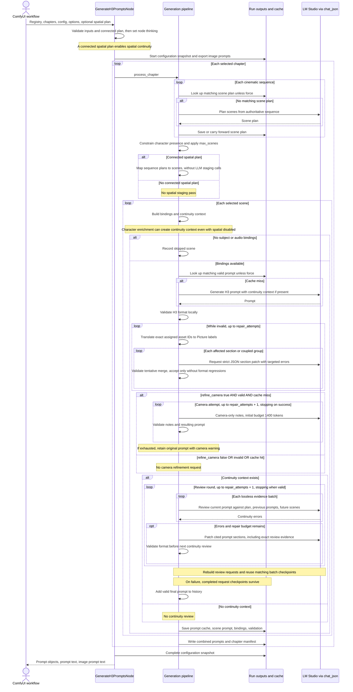

# Generate H3 Prompts: execution and failure analysis

This describes the implementation inspected on 2026-11-11. Related: [architecture map](../architecture.md), [node wrapper](../../src/nodes/generate_h3_prompts.py), [generation pipeline](../../src/core/pipeline_step3_generate.py), [JSON transport](../../src/core/lmstudio_json.py).

## Current sequence

Every LLM arrow below first checks an exact-request checkpoint, then uses the shared structured-JSON transport on a miss. Successful structured responses are saved immediately. One miss can produce multiple HTTP requests through transport retries. All scenes are processed sequentially.

## Connection and camera control

Format repairs preserve unaffected sections verbatim. Errors sharing a section are repaired together; malformed section structure requires an atomic six-section patch. `repair_attempts` bounds repair rounds, each of which can issue one request per affected group. A rejected patch keeps the original wording and supplies diagnostic feedback to the next round. Logs identify the target sections, acceptance/rejection, and format error counts. Exact-request caches store model responses, including rejected proposals, but every cached proposal must pass the same merge validation again.

Continuity patches remain provisional until the next full continuity review. Cited section paths determine their scope; issues without a specific section citation and changed input metadata can require multiple sections. Exhausted format failures remain invalid and do not enter continuity history.

| Connected spatial plan | Staging input | Final continuity review |
|---|---|---|
| Yes | Reuse connected sequence plan | Yes |
| No | No spatial staging | No, unless character enrichment creates continuity context |

`refine_camera` is independent of this table. It adds camera-only notes to a valid, newly generated prompt. Turning it off does not remove camera instructions already present in prompt generation, the spatial plan, or `camera_direction`. Its output is subsequently subject to continuity review.

`thinking` controls planning, generation and format repairs. `camera_thinking` controls the optional camera pass, and `review_thinking` controls continuity reviews and their repairs. All three default to false. They use the shared model-specific transport: GPT-OSS still always reasons, and OpenAI has no thinking switch. Overrides are restored after each task, including errors and cancellation.

Connect Spatial Continuity or Load Spatial Continuity to enable spatial planning context and final-prompt review. The redundant spatial checkbox and internal staging fallback have been removed. The connected plan defines intended staging; review checks actual generated wording. Camera refinement remains optional and independent.

The bundled example uses the current widget order. For other saved workflows containing the removed checkbox, recreate Generate H3 Prompts and reconnect its inputs before running, then restore the desired settings. This avoids positional widget values shifting into camera_direction or resume_run. No legacy widget format is supported.

## Diagnosis of the reported failure

The reported workflow connected Load Spatial Continuity (140) to Generate H3 Prompts (212). Node 212 had thinking on, max_tokens 8192, repair_attempts 2, refine_camera on, spatial continuity on, max_scenes 0 (all scenes), and no resume_run. The bundled example now omits the removed checkbox and retains that connection.

The failing call is the final-prompt continuity reviewer, not scene planning or camera refinement. The supplied trace records:

- HTTP 200: the server accepted and streamed the request.
- Attempt 2, max_tokens 16384, finish_reason length.
- 69,214 reasoning characters and zero answer-content characters.
- Parsing an empty answer raises JSONDecodeError, which the transport reports as StructuredOutputLengthError.

Reasoning and JSON share the completion budget. Gemma exhausted that budget before emitting JSON. The current Gemma profile allows one transport retry: an initial 8192-token request can retry at 16384 after reasoning truncation. It keeps thinking enabled. The configuration option qwen35_length_retries does not control Gemma. The node's repair_attempts controls semantic/format repair loops, not this transport retry count; a transport exception exits before a review result can be repaired.

LM Studio reports about 170.8 seconds for the last request. The 25,720-second ComfyUI profile is the cumulative node execution. These excerpts prove why the run stopped, but do not provide a per-stage breakdown of the preceding seven hours. They do not show a context-window overflow; increasing context size alone would not fix the output-budget failure. The attached text snapshot was empty.

## Performance and recovery behavior

1. **Repeated chapter-wide review.** Each scene is reviewed against all previous valid final prompts and all remaining scenes. Context is packed without dropping evidence, with a 48,000 UTF-8-byte request budget; overflow creates additional review requests. Across N scenes this can approach quadratic evidence processing. Repairs repeat the batches.
2. **Nested retry costs.** With repair_attempts 2, a scene can have up to three camera attempts and three continuity review rounds, plus format and continuity repairs. Each LLM call can itself retry. Camera requests begin at 1400 tokens and now use camera_thinking, default false. Explicitly enabling reasoning can still escalate a truncated retry to 16384 tokens.
3. **Cached reviews avoid model calls.** Valid final prompts still undergo local validation and reconstruct their review requests. Each matching batch response is read from disk, schema-checked, and passed through the normal reviewer-result checks. Review is never skipped solely because a prompt was cached.
4. **Early request checkpoints.** Generation, camera, repair, and individual review responses are saved before subsequent stages run. An exception is never cached. The final scene output is still written after review, and the chapter manifest/combined text after the chapter completes. Intermediate responses are drafts, not validated deliverables.
5. **Two levels of invalidation.** Plan/final-prompt keys include node settings and implementation fingerprints; final-prompt keys also include all future scenes. Request keys use the exact instructions, payload, schema, model, endpoint digest, effective model controls, temperature, token budget and transport/profile implementation. Changing review thinking can reuse available generation checkpoints. Changed evidence redoes only requests whose full inputs differ. Only checkpoints present in the current or selected previous run can be reused.
6. **A small max_scenes is only a generation smoke test.** The cap is applied after planning all sequences in the chapter. It reduces subsequent per-scene work but does not avoid all planning calls. Lowering scenes_per_chunk changes scene selection and can omit story moments; it is not merely a performance adjustment.

## Immediate operational recommendations

- The example now uses thinking=false, camera_thinking=false, review_thinking=false and refine_camera=false, retaining the connected spatial plan. The Gemma profile sends chat_template_kwargs.enable_thinking=false. Verify that the loaded LM Studio runtime/template honors it; the transport raises an explicit error if reasoning is still returned. This behavior has not been tested against the user's live server here.
- Enable refine_camera if the additional camera polish is useful. Its thinking setting is independent of generation and review.
- Keep force=false. To attempt reuse, set resume_run to the failed run's timestamp folder and keep the same out_dir. Only matching caches are reused; the settings changes above will invalidate affected entries. Preserve the failed run for recovery and inspection.
- If thinking is required, increasing max_tokens (for example to 32768) is an alternative experiment, subject to the loaded model's context capacity. It can cost substantially more time and does not guarantee termination with JSON.
- Test one chapter with a small max_scenes before a full run, accounting for the planning caveat above. Disconnecting the plan removes its staging context and spatial review, so it should not be used merely to suppress this error without accepting the loss of checks.

## Checkpoint storage and measurement

[generation_requests.py](../../src/core/generation_requests.py) stores responses atomically at `<timestamp>/<out_dir>/.cache/<chapter_id>/requests/<request_hash>.json`. A record contains the response and integrity digest, not credentials or raw reasoning. Cache reads verify the request key, integrity digest and JSON schema. Completed responses reused from a previous run are carried into the current run. `force=true` bypasses all cache reads. Stop checks also run on cache hits.

The chapter cache's `request_metrics.json` records the last stage/status and per-task call counts, checkpoint hits, HTTP completion attempts reported by the shared transport, estimated input/output tokens, and elapsed seconds. Continuity corrections are counted under continuity_review. Console messages identify chapter, sequence/scene and task request number, including the checkpoint path on failure. Token counts are estimates, and SDK-internal HTTP retries are not separately counted. Metrics measure the current execution, not cumulative history across resumed runs.

Existing runs created before request checkpointing cannot supply missing intermediate responses. New fingerprint dependencies may invalidate their plan/final-prompt entries. No old-cache fallback bypasses the new validation dependencies.

The remaining potential optimization is reducing repeated history context. This implementation deliberately retains every previous/future observation and the existing lossless batching. Replacing that with compact entity/location state requires separate evidence-coverage validation. No live seven-hour workload speedup is claimed from offline tests.
